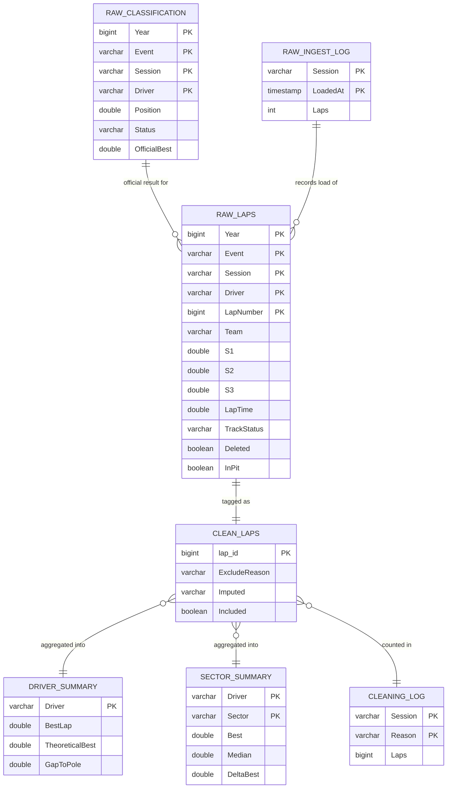
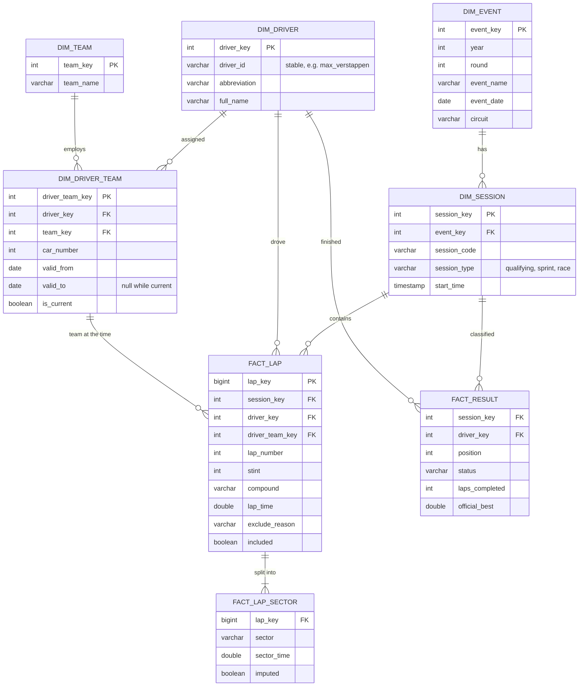

# Data model

How the tables relate, what one row of each represents, where the current model is weak, and the dimensional model it should grow into.

## Current model

The warehouse ([WAREHOUSE.md](WAREHOUSE.md)) and the CSVs share one model: wide tables joined on natural keys, with no separate dimension tables.

Summary tables also carry Year, Event and Session in their keys; the diagram shortens them.

| Table | Grain (one row is) | Key |
|---|---|---|
| `raw.laps`, `clean.laps` | one lap by one driver in one session | Year, Event, Session, Driver, LapNumber (checked unique on the 2024 season) |
| `raw.classification` | one driver's official result in one session | Year, Event, Session, Driver |
| `marts.sector_summary` | one driver, session and sector | Year, Event, Session, Driver, Sector |
| `marts.driver_summary` | one driver and session | Year, Event, Session, Driver |
| `marts.cleaning_log` | one session and reason, **two kinds of count mixed** | Year, Event, Session, Reason |
| `raw.ingest_log` | one load of one session | Year, Event, Session, LoadedAt |

### Weak points

1. **Team is stored on every lap.** A driver's team is a fact about the driver at a point in the season, not about a lap. In 2024 five teams changed line-ups (Alpine, Ferrari, Haas, RB, Williams) and Bearman drove for both Ferrari and Haas. Copying the team onto 36,612 laps works, but there is no table that answers "who drove for whom, and when".
2. **No dates or round numbers.** Events are identified by name only, so SQL cannot put the season in order; `ORDER BY Event` is alphabetical. Any "before and after" question, including the team changes above, needs a date.
3. **Natural keys that are not stable over time.** Event names change: the Brazilian Grand Prix became the São Paulo Grand Prix in 2021. Driver numbers change too: Verstappen raced as 33, then as 1 after winning the title. Across seasons, both need a stable surrogate key.
4. **Mixed grain in `cleaning_log`.** Lap counts per reason and imputation counts sit in one table, so summing `Laps` double counts. It needs a `CountType` column or two tables.

## Target model: a star schema

Facts hold measurements at a fixed grain; dimensions describe the who, where and when. The driver's team becomes a dimension that changes over time (a Type 2 slowly changing dimension).

What changes:
* **One place for each fact.** Team, car number and dates live in dimensions; facts hold only keys and measurements.
* **History is kept, not overwritten.** When Bearman moves from Ferrari to Haas, `dim_driver_team` gets a new row with its own `valid_from`, and the old row is closed with a `valid_to`. Every lap points at the assignment that was true when it was driven.
* **Surrogate keys** (`driver_key`, `event_key`) stay stable when names or numbers change.
* **Marts become simple queries** over facts joined to dimensions, and a BI tool or semantic layer can define each metric once on top of them.

To build it, the loader would also need FastF1's event schedule (dates, rounds, circuits) and stable driver ids, which come with the results data.

## The same problem in People Analytics

| F1 | HR data |
|---|---|
| Driver | Employee |
| Team | Department, team or manager |
| `dim_driver_team` with `valid_from` / `valid_to` | Effective-dated job history: an employee's department, title, level and manager over time (Type 2) |
| Lap, result | Events and snapshots: hires, promotions, transfers, exits, monthly headcount |
| Deleted lap, found later | Backdated change, such as a termination entered two weeks after it took effect |
| Reconciling against the official classification | Reconciling HRIS headcount against payroll |
| Stable `driver_id`, not number or name | Stable employee id, not email or name, which change |

With history kept as Type 2 rows, questions like "what was attrition in Engineering last quarter" or "were promotion rates similar across groups" have one correct answer. If a transfer overwrites the department instead, those answers silently change.
