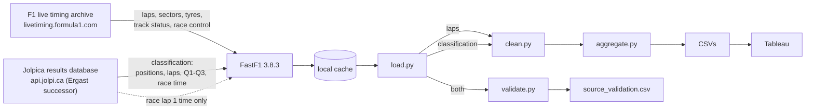

# Data sources and validation

Where every number in this project comes from, how far each source can be trusted, and how the pipeline checks one source against another.

## Lineage

| Field | Source | Official? |
|---|---|---|
| Sector times, lap times (lap 2 onwards) | F1 live timing stream, reassembled by FastF1 | Derived from the feed that drives F1's live timing app, not the FIA's timing system |
| Race lap 1 time | Jolpica, filled in by FastF1 because the stream has none | Official result data |
| Tyre compound, tyre age, stint | Live timing (FastF1 corrects known stint errors and logs a warning) | Derived |
| Track status (flags, safety car, red flag) | Live timing | Official race control signal |
| Deleted laps (track limits) | Race control messages, matched to laps by FastF1 | Official, but a message without a lap number cannot be matched (see below) |
| Positions, status, laps completed, Q1/Q2/Q3, race time | Jolpica | Built from the published FIA classification |

[FastF1](https://github.com/theOehrly/Fast-F1) is an open source Python library (MIT license). Timing data belongs to Formula One World Championship Limited. This project is unofficial.

## How the sources are checked against each other

`validate.py` runs three checks on every loaded session and writes the results to `source_validation.csv`. Each row ends up as `match`, `explained` (a known difference in definition), `not_comparable` (the feed lacks what the check needs) or `MISMATCH`.

1. **Best qualifying lap.** Each driver's best non-deleted lap in the feed must equal their best official Q1/Q2/Q3 time, to the millisecond.
2. **Laps completed.** The number of laps each driver has in the feed must equal the official count.
3. **Winner's race time.** The winner's lap times must add up to the official race time, to the millisecond. Lap 1 comes from Jolpica (see above), so this check is independent for every lap but the first.

### Results: full 2024 season (24 events, Q, sprint and race, 36,612 laps)

| Check | Match | Explained | Not comparable | Mismatch |
|---|---:|---:|---:|---:|
| Best qualifying lap | 474 | 0 | 0 | 4 |
| Laps completed | 566 | 33 | 0 | 0 |
| Winner's race time | 15 | 0 | 15 | 0 |

**What the explained and not comparable rows are:**
* **32 retirements.** The feed includes the lap the car stopped on, which has no time; the classification counts only completed laps.
* **1 disqualification.** Hülkenberg in São Paulo: the feed has his 30 laps, while the classification counts none.
* **15 sessions where a winner's lap has no time**, so the laps cannot be summed. In 6 sprints it is lap 1, because Jolpica supplies lap 1 only for Grands Prix. In 9 Grands Prix it is one or more laps under a safety car, virtual safety car or red flag, or just after a restart. In all 15 sessions where every lap has a time, the laps add up to the official race time exactly, to the millisecond.

**The four mismatches:**
* **Alonso, São Paulo qualifying.** The feed has a 1:25.035 on a green flag, not deleted and marked accurate. His official best is 1:28.998. The next lap shows a red flag, so the most likely cause is a lap completed as the red flag came out, which does not count. The pipeline used this lap as his best until this check existed.
* **Gasly, Azerbaijan qualifying.** The feed has a 1:43.088 against an official 1:43.179. Race control deleted a lap for a double yellow flag, but the message has no lap number, so FastF1 could not mark the lap deleted.
* **Zhou, Saudi Arabia, and Sargeant, Imola qualifying.** The feed has laps for both, while the classification lists no qualifying time. Not yet explained.

**What changed because of it.** A new cleaning rule, `not_counted`, excludes any qualifying lap faster than the driver's official best. If a lap had been counted, the official best would be at least that fast. Across the season it removes 3 laps: both Alonso laps faster than his official best, and the Gasly lap, which the `track_status` rule had already excluded. None of the four sample events is affected.

## Known limits of the source

* **The feed is not the FIA's timing system.** It is the stream behind F1's live timing app. The checks above show it agrees with the official results to the millisecond whenever both have a value.
* **Missing values follow a pattern.** S1 goes missing on laps that do not start with a normal crossing of the timing line: lap 1, the first lap out of the pits, restarts. Those laps are excluded anyway. Across 2024, 716 laps had one value rebuilt from the other three and none of them reached a metric.
* **FastF1 corrects some data itself** and logs a warning, for example "Fixed incorrect tyre stint information" for one driver at Silverstone.
* **Wet races.** `stint_trends` assumes tyre age drives the change in lap time. In a drying race the track dominates instead, and the slopes come out negative (São Paulo 2024: 32 of 33 stints).

## Access and reproducibility

* **Upstream access.** The 2024 season was downloaded anonymously between 2026-09-30 and 2026-10-03; all 408 requests to the official live timing archive succeeded. Since at least 2026-10-18 the archive returns HTTP 401 for 2024, 2025 and 2026 session files, with headers showing the refusal is generated by a function on F1's CDN rather than a missing file, and FastF1's mirror returns 404. New lap timing and telemetry currently cannot be downloaded. Official results from Jolpica are still available. The reason for the change is not confirmed; F1 has been restricting access to its timing feeds.
* **The local cache is the only copy** of the 2024 raw data (409 files, 222 MB). It is backed up off-machine as a zip with a SHA-256 manifest of every file.
* **The backup was tested.** Restored to an empty folder with FastF1 in offline mode, it reproduces every committed CSV in `data/2024` exactly.
