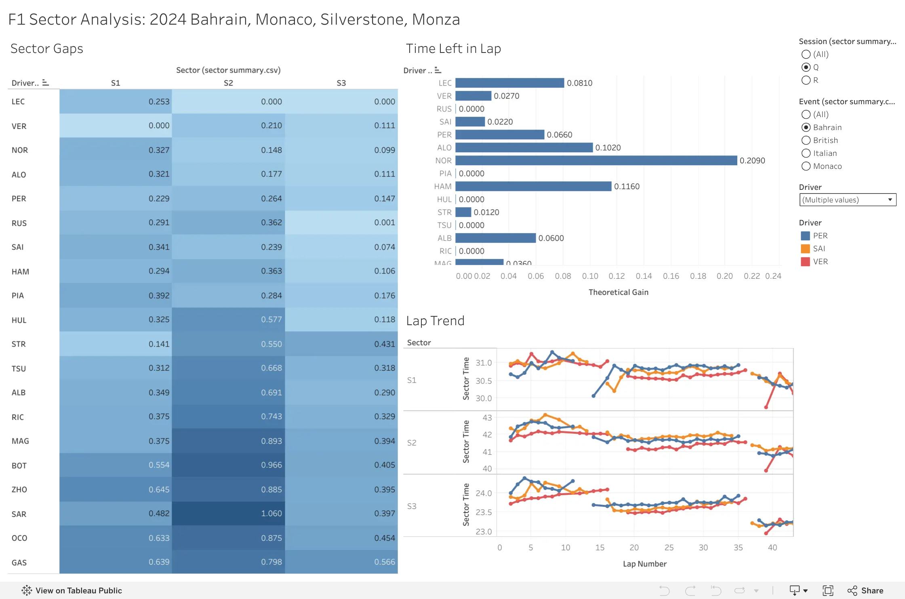
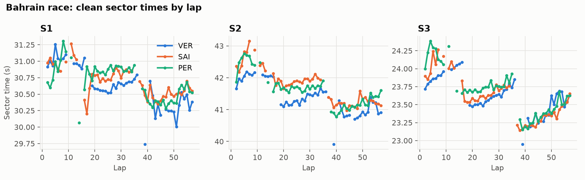

# F1 Sector Analysis

[](https://github.com/mayankpm/f1-sector-analysis/actions/workflows/ci.yml)

A Python pipeline built on [FastF1](https://github.com/theOehrly/Fast-F1) that pulls official Formula 1 timing data, cleans it, and compares sector times across drivers and sessions. The output is a set of tidy CSVs that feed a Tableau workbook for exploration, plus static charts for a quick look.

**Interactive dashboard on Tableau Public: [F1 Sector Analysis 2024](https://public.tableau.com/app/profile/mayank.manohar.polepalli/viz/F1SectorAnalysis2024/Overview)**

[](https://public.tableau.com/app/profile/mayank.manohar.polepalli/viz/F1SectorAnalysis2024/Overview)

## What it does

1. **Load** laps for any set of events and sessions (practice, sprint, qualifying, race) through FastF1, with a local cache so reruns are offline.
2. **Clean** every lap. Nothing is silently dropped: each lap gets an `ExcludeReason` so exclusions can be audited and filtered.
3. **Aggregate** per driver, session and sector: best, median, spread, gap to the fastest driver, gap to the field median, gap to the teammate, and the theoretical best lap built from each driver's best sectors.
4. **Trend** race pace over each tyre stint: a least squares slope of every sector against tyre age.
5. **Export** CSVs for Tableau and render PNG charts.
6. **Warehouse** (optional): the same cleaning and summaries as layered SQL in DuckDB, with idempotent loads and SQL data tests. It matches the pandas output exactly on the full 2024 season. See [WAREHOUSE.md](WAREHOUSE.md), and [DATA_MODEL.md](DATA_MODEL.md) for the entity-relationship diagrams and the star schema it should grow into.

## Handling missing and outlier laps

Rules run in order and the first match wins.

| Rule | What it catches |
|---|---|
| `deleted` | Lap time removed by race control for track limits |
| `not_counted` | A qualifying lap faster than the driver's best official time, so it was not counted (found by the [source checks](DATA_SOURCES.md)) |
| `pit_in_out` | In laps and out laps |
| `track_status` | Any yellow flag, safety car, VSC or red flag during the lap |
| `standing_start` | Lap 1 of a race or sprint |
| `missing_timing` | A sector or lap time is still missing after imputation |
| `timing_mismatch` | S1 + S2 + S3 differs from the lap time by more than 0.1 s |
| `slow_lap` | Slower than 107% of the driver's own best clean lap in that session (cool down laps, wet laps, damage) |
| `sector_outlier` | A sector more than 3.5 robust standard deviations slower than the driver's median for that stint |

**Imputation.** When exactly one of S1, S2, S3 and the lap time is missing, it is rebuilt from the other three, since the lap time is the sum of the sectors. Imputed values are marked in the `Imputed` column, and the cleaning log counts them twice: `imputed_<col>` for every rebuilt lap and `imputed_<col>_used` for the ones that pass every rule and so reach a metric.

In practice the data is only ever missing a value on laps that are excluded anyway. In the sample below, 68 laps were imputed (59 race S1 times, 9 lap times) and all 68 were later excluded as standing starts, safety car laps or pit laps. Over the full 2024 season (see below) it is 716 imputed laps and 0 used. FastF1 drops S1 on lap 1 and on the lap after a pit stop or restart, most likely because those laps do not begin with a normal crossing of the timing line; it never dropped a sector on a clean racing lap. Imputation stays in as a safeguard, so a lap with a gap is judged on its pace by the later rules instead of being labelled `missing_timing`, and so `sector_laps.csv` has complete lap traces when Tableau shows excluded laps.

**Outlier design choices.**
* The robust z score uses the median and MAD rather than mean and standard deviation, so the outliers being hunted do not inflate the threshold.
* Scores are computed per stint, so a fresh set of tyres or a lighter car does not make the previous stint look like an outlier. Stints under 5 laps fall back to the driver's whole session.
* Only the slow side is flagged. An early version flagged both sides and threw away real fastest laps (Verstappen's 1:32.608 in Bahrain, Hamilton's 1:14.165 in Monaco) because they were unusually fast for the stint. Traffic and mistakes cost time; fast timing glitches are already caught by `timing_mismatch`.
* The MAD is floored at 0.05 s. Without it, a very consistent driver's normal 0.1 s wobble reads as an outlier.

## Sample run: 2024 Bahrain, Monaco, Silverstone, Monza (qualifying and race)

```
f1sector --year 2024 --event Bahrain --event Monaco --event British --event Italian --plots --out data/2024
5671 laps loaded, 3523 used for pace (2148 excluded)
```

| Reason | Bahrain Q | Bahrain R | Silverstone Q | Silverstone R | Monza Q | Monza R | Monaco Q | Monaco R |
|---|---:|---:|---:|---:|---:|---:|---:|---:|
| included | 78 | 937 | 81 | 514 | 71 | 841 | 127 | 874 |
| pit_in_out | 182 | 85 | 191 | 92 | 184 | 61 | 181 | 45 |
| slow_lap | 0 | 2 | 72 | 231 | 4 | 1 | 78 | 280 |
| sector_outlier | 5 | 49 | 16 | 96 | 5 | 72 | 10 | 14 |
| track_status | 0 | 36 | 0 | 0 | 10 | 0 | 9 | 19 |
| deleted | 2 | 20 | 8 | 9 | 2 | 13 | 21 | 5 |
| standing_start | 0 | 0 | 0 | 18 | 0 | 20 | 0 | 0 |

The Silverstone race was run in changing wet conditions, which is why so many of its laps fall outside 107% of each driver's best. In Monaco, after the lap 1 red flag, most of the field ran one set of hard tyres to the finish at a managed pace (the median of these cut laps is 1:21.3). The late push laps set each driver's best, so the managed laps fall outside 107%.

**Checked against a second source.** Every run reconciles the lap timing against the official classification, which FastF1 loads from a separate results database, and writes the outcome to `source_validation.csv`. In this sample all 80 qualifying times match the official ones to the millisecond, and so do the summed lap times of the three winners whose laps all have a time. [DATA_SOURCES.md](DATA_SOURCES.md) covers where each field comes from and the full season results.

**Sanity check.** Pole times and the race fastest lap for all four events match the official results: pole for Norris at Monza (1:19.327), Russell at Silverstone (1:25.819) and Leclerc at Monaco (1:10.270), and fastest laps for Verstappen in Bahrain (1:32.608), Sainz at Silverstone (1:28.293), Norris at Monza (1:21.432) and Hamilton in Monaco (1:14.165). In Bahrain the pipeline's quickest qualifying lap is Leclerc's 1:29.165 from Q2, 0.014 s faster than Verstappen's pole lap in Q3, because the summary covers every lap of the session.

### Full 2024 season check

The same rules, run unchanged over every 2024 qualifying, sprint and race session (24 events, 54 sessions):

```
f1sector --year 2024 --event 1 --event 2 ... --event 24 --session Q --session S --session R
36612 laps loaded, 24074 used for pace (12538 excluded)
```

| Reason | Laps |
|---|---:|
| included | 24074 |
| pit_in_out | 6141 |
| slow_lap | 1912 |
| track_status | 1877 |
| sector_outlier | 1733 |
| deleted | 475 |
| standing_start | 376 |
| timing_mismatch | 13 |
| missing_timing | 8 |
| not_counted | 3 |
| imputed (S1 450, lap time 266) | 716, of which 0 used |

Every rule fires somewhere in the season. The two timing rules never trigger in the four event sample but catch 21 laps across the year where the sectors do not add up to the lap time or two values are missing at once. `not_counted` catches 3 qualifying laps that look valid in the timing feed but were never counted officially; one of them, at São Paulo, made Alonso's best lap 3.96 s too fast before the rule existed.

Against the official classification, 474 of 478 best qualifying laps match to the millisecond, every lap count matches once retirements and one disqualification are accounted for, and the winners' lap times sum to the official race time exactly in all 15 sessions where every lap has a time. The four qualifying mismatches are listed in [DATA_SOURCES.md](DATA_SOURCES.md). The CSVs for this run are not committed (about 13 MB); the command above rebuilds them from the FastF1 cache.

### A few things the data shows

* **Monza qualifying.** Norris took pole while being 0.17 s off the best first sector (Sainz). He won it in S2 and S3, gaining 0.197 s on Piastri there, which made the difference.
* **Bahrain race.** Verstappen's lead was built in S2, the twisty middle section, where his median clean lap in the second stint was 0.59 s quicker than Sainz and 0.38 s quicker than Perez.
* **Tyre stints.** The median lap time slope on softs was +0.069 s per lap in Bahrain, a high wear track, but on hards in Monaco it was 0.049 s per lap *faster* every lap: with barely any tyre wear, fuel burn dominates.



## Output tables

All written to `--out` (default `output/`). Times are in seconds.

| File | Grain | Use |
|---|---|---|
| `sector_laps.csv` | lap and sector, all laps including excluded ones | Distributions, lap by lap trends, filtering on `Included` or `ExcludeReason` |
| `sector_summary.csv` | driver, session, sector | Best, median, P25, P75, std, `DeltaBest`, `DeltaMedian`, `RankBest`, teammate deltas |
| `driver_summary.csv` | driver, session | Best lap, theoretical best, time left in the lap, gap to pole, weakest sector |
| `stint_trends.csv` | driver, race stint | Slope of each sector and the lap against tyre age |
| `session_comparison.csv` | driver, event, sector | Each driver's sector deltas side by side across sessions (qualifying vs race) |
| `cleaning_log.csv` | session, reason | Lap counts per exclusion rule and per imputed column |
| `source_validation.csv` | session, driver, check | Lap timing reconciled against the official classification: `match`, `explained`, `not_comparable` or `MISMATCH`, with a note |

The CSVs from the 2024 run are committed under [`data/2024`](data/2024) and feed the [published Tableau dashboard](https://public.tableau.com/app/profile/mayank.manohar.polepalli/viz/F1SectorAnalysis2024/Overview). See [TABLEAU.md](TABLEAU.md) for how it is built.

## Usage

```bash
python -m venv .venv
.venv/bin/pip install -e ".[dev]"        # Windows: .venv\Scripts\pip

f1sector --year 2024 --event Bahrain --event 8 --session Q --session R --plots
f1sector --year 2023 --event Japan --session FP2 --session Q --out output/suzuka
f1sector-warehouse --year 2024 --event Bahrain --event Monaco --session Q --session R   # DuckDB version
```

`--event` takes a name or a round number (round numbers are passed to FastF1 as integers; as strings it would fuzzy match them to an event name). Asking for the same session twice, for example `--event Bahrain --event 1`, loads it once. `--session` defaults to Q and R. `--slow-factor` and `--outlier-z` tune the cleaning thresholds. The first run of a session downloads it (about 10 s each); later runs read the FastF1 cache in `cache/`.

`f1sector-warehouse` takes the same `--event`, `--session`, `--slow-factor` and `--outlier-z` options and writes a DuckDB file (default `warehouse/f1.duckdb`) instead of CSVs. Each session is loaded into `raw` in one transaction, replacing any earlier copy, then the `staging`, `clean` and `marts` layers are rebuilt and the 6 SQL data tests run. It prints row counts per layer and exits non-zero if any data test fails. Query the result with `duckdb warehouse/f1.duckdb` or `duckdb.connect()` in Python; [WAREHOUSE.md](WAREHOUSE.md) has the layers, the data tests and example queries.

## Tests

```bash
pytest
```

47 tests: 17 on the cleaning rules, 10 on the summaries, 6 on the source checks, 5 on the warehouse and 3 on loading. They use synthetic laps with known answers (a known degradation slope, a known theoretical best, one lap broken per rule) and never touch the network. The warehouse tests run the same synthetic data through pandas and SQL and require identical results. CI runs them on Python 3.10 and 3.12.

## Layout

```
src/f1sector/
  load.py       FastF1 session loading, timedelta to seconds, pit flags
  clean.py      imputation and exclusion rules
  validate.py   reconciliation against the official classification
  aggregate.py  sector summaries, teammate deltas, theoretical best, stint slopes
  export.py     pipeline wiring and CSV output
  warehouse.py  DuckDB loading, SQL layers and data tests
  sql/          staging, clean and marts SQL, plus SQL data tests
  plots.py      README charts (matplotlib)
  cli.py        command line entry point
tests/          pytest suite on synthetic data
data/2024/      sample output: CSVs and charts
```

## Data

Lap timing comes from the F1 live timing service and the official classification from the Jolpica results database, both through FastF1. [DATA_SOURCES.md](DATA_SOURCES.md) has the lineage, the checks between the two, the known limits of the feed, and the current access status: since October 2026 the live timing archive refuses downloads, so new sessions cannot be fetched and the local cache, backed up off-machine, is the only copy of the 2024 data. This project is unofficial and is not associated with Formula 1 or the FIA.
